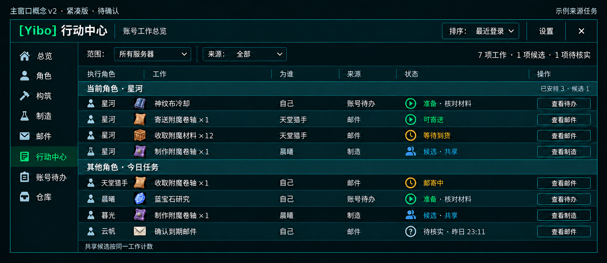
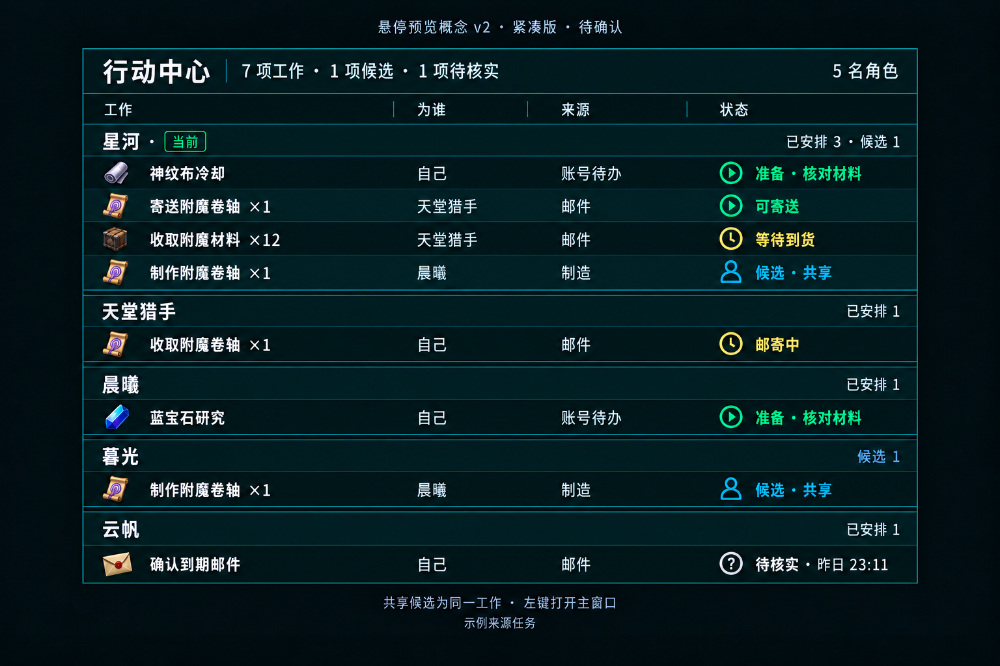

# YiboTaskHub 页面概念 v2：紧凑布局

日期：2026-10-09。

> 当前状态（2026-10-16）：现有功能已由用户实机验收收口；本文保存概念与迭代依据，当前目标行为以TaskHub说明及现行契约为准。复杂任务链见[DEV-003](../../后续开发任务清单.md)。

## 紧凑布局迭代的保留结论（2026-10-16 提炼）

2026-10-09的0.2.1截图显示：账号334项工作中326项待核实，逐项铺开需要28页，已确认行动难以找到。后续0.3.0的收拢针对这一问题，不用概念图示例数量作为正式容量门槛。

- 主窗口共用表头，当前角色与其它角色分区；默认单行，保留Core正文／辅助字号，相邻区域只绘制一条边界线。
- 待核实内容的折叠只改变展示投影，按角色、来源、来源代际、候选属性与受益者区分；展开后保留原始身份和数量，不改来源状态或任务安排。具体折叠范围沿用当前实现。
- 统计基于同一原始集合按任务身份去重，分页按实际展示高度计算；筛选不能把隐藏明细解释成没有任务。
- 悬停先保障有效角色摘要，再使用剩余容量展示明细；长邮件主题不串成大段摘要，完整内容按需查看。
- 角色名称与身份提示复用Core；来源提供工作图标与业务状态，中心复用公共解析和显示能力，不另建库存或判断副本。
- HUD／登录入口应让当前角色工作可发现；来源／状态筛选、角色准入和页面范围的边界须保持明确。

历史画面：[0.2.1主表](TaskHub-Client-0.2.1-Main.png)、[0.2.1悬停](TaskHub-Client-0.2.1-Hover.png)。这些是修订前的问题证据，不当作后来版本的验收截图。该轮327项离线检查及74项唯一工作／75次投影折叠为7行的结果保留为当时验证，实际游戏效果按独立客户端证据记录。

状态：**已确认（暂定 v2 基线）**。用户认可紧凑版，补充“相邻区域共用一条线，不要有两个外框相邻”，要求把图片保存到插件 Media 并继续开发。O2 已恢复，概念图仍使用示例来源任务，不代表制造、邮件或跨角色下发已经实现。

依据：[产品与任务模型方案](../../行动中心-产品与任务模型方案.md)、[文件级实施计划](../../行动中心-文件级实施计划.md)、仓库 PRODUCT.md 与 YiboCore 的 Theme／AccountView。使用 Impeccable 梳理信息层级，Imagegen 生成并修正概念图；提示词另存于 [v1 提示词](生成提示词.md)、[v2 提示词](生成提示词-v2.md)。

2026-10-09 客户端基线：用户确认 [0.1.1 主页面截图](TaskHub-Client-0.1.1.png) 看起来没问题并继续开发；确认范围为外观、多来源和分页。O4 0.2.0 已实现只读悬停与 HUD；高度不足时悬停压缩为每角色一行摘要，极小屏幕明确提示剩余角色，正文保持单行及单条分隔线。219 项自动化通过，新展示仍待客户端验收，见 [O4 记录](../../行动中心-O4-展示与提醒记录.md)。

## 概念图

### 主窗口：当前角色在上，其他角色在下

- 沿用 Core 的标题栏、左侧业务导航与设置入口；行动中心只提供右侧内容。当前选中页用底色、文字和图标标识。
- 上方保留范围与来源筛选，右侧显示账号去重统计；范围、角色准入和排序复用 Core。
- 上方为当前角色的已安排工作和开放候选；下方为其他角色今日工作。两块同时可见，便于决定现在做什么、接下来登录谁。候选直接在行内标识，不占独立分组标题。
- 共用一个表头：执行角色、工作、为谁、来源、状态、操作。其他角色名称直接放在任务行中；同一角色的多条工作保持相邻，不再为每个角色额外占一行标题。执行者和受益者分别显示。
- 每项任务默认单行，图标与文字同高；准备原因缩为“准备·核对材料”，过期观察时间缩为“待核实·昨日23:11”。更长的原因、候选名单与完整时效在主窗口按需查看，不常驻第二行。
- 来源操作通过“查看待办／邮件／制造”等入口跳转；实际来源没有入口时只展示。按钮采用行内紧凑尺寸。

### 悬停：同一集合的只读账号预览

- 当前角色先显示，其他有效业务角色继续按组显示；示例有 5 名角色。正式预览遵循账号悬停最多 20 名有效角色的约定，不退化为仅当前角色。
- 标题、账号统计与角色数合并为一个紧凑标题带；只保留一个列头。每项任务压缩为单行工作、为谁、来源和状态，省略导航、筛选和行操作。
- 角色名与已安排／候选统计合并成薄标题行；角色之间只用细分隔线，不增加空白段。候选行不再另设标题，也不常驻第二行解释。
- 悬停没有承接、完成、编辑或跳转控件；底部“左键打开主窗口”描述入口行为，行内箭头已移除。
- 采用任务型独立布局，作为仓库悬停规范允许的任务型例外：与主窗口复用同一快照、角色准入、状态、数量格式和去重统计；仍由 Core 创建、定位与关闭。
- 图片为放大的阅读概念，尺寸与行高不直接作为游戏像素规格。悬停不以长列表滚动承载完整清单；超出安全边界时保留有效角色摘要、统计与明确的剩余任务数量，完整工作在主窗口分批查看。相关容量与 Core 支持方式须在实施前核对。

## 密度与容量约束

- 相邻行、分区或面板共享一条边界线：连续表格只统一绘制外轮廓与内部单条分隔线，不能为每行／分区重复画完整外框。O2 行组件仅绘制自己的底部 1px 线，不增加相邻顶部线；外轮廓复用 Core 壳。
- 保留 Core 可读字号，复用 `UITheme.Font.body`（当前 16）、`assist`（14），压缩标题、图标和留白，不靠缩小正文解决容量。
- 任务行优先复用 Core `Table.rowHeight`（当前 28）、`previewRowHeight`（26）；薄分组标题与这些行高接近。只有实际需要且用户主动查看的详情可以增加高度，不能因说明文案自动扩成双行。
- 示例的 8 次任务展示在两个展示面均须一次看到。主窗口结构为 8 个任务行、2 个分区条和 1 个表头；悬停为 8 个任务行、5 个薄角色标题和 1 个表头。
- 以当前 Core 行高估算，主窗口表体为 `8×28 + 2×28 + 28 = 308` UI 单位；加现有窗口壳、筛选条和必要边距约 430～460。悬停表体为 `8×26 + 5×26 + 28 = 366`，加标题和底部约 430～460。此为实施布局预算，不是生成图片实测或客户端验收结果。
- 先在屏幕安全范围内使用可用宽度，确保身份、数量、关键状态和“为谁”可读。长标题可省略并在主窗口查看全文；不能因单个长标题扩大整行，也不能引入水平滚动才能理解任务。
- 工作量超过一屏预算时，主窗口按实际内容高度分批／分页，不以固定角色数作为阈值。显示总数、当前范围与剩余数量，保留角色摘要帮助选择。分页与来源筛选只改变展示，不丢弃或改写来源工作。
- 悬停容量有限时仍覆盖有效角色（最多 20 名）的摘要，必要时在安全宽度内分栏；工作明细按容量投影并显示“另有 N 项”，不把隐藏明细当作无任务，也不只保留当前角色。候选与待核实数量持续可见，账号统计仍按完整同一快照去重。分栏与容量投影属于待验证的展示方案，不假定 Core 已有相应接口。
- 实施时用短任务、长中文名称、多候选、20 个有效角色及超出一屏的工作量验证；不能只用此 8 行示例判断真实容量已满足。

## 两个展示面的共同规则

| 信息 | 两图约定 |
| --- | --- |
| 准备／可寄送 | 绿色箭头形状加文字；准备不表示已完成，冷却就绪也不表示材料齐全 |
| 等待到货／邮寄中 | 黄色时钟加文字；保留物流中的工作，避免提示重复制作 |
| 候选 | 蓝色人物形状加文字；与已安排分组区分，不因登录而自动承接 |
| 待核实 | 灰色问号加文字；显示快照过期及观察时间，不推断可推进或无任务 |
| 多角色共同候选 | 同一工作可在多个角色下出现，但账号总数只计一次；说明共享身份 |
| 今日与完成 | 由来源业务判断，中心不按本地午夜重新建立任务 |

## 示例任务与核对

任务编号仅用于设计核对，不是运行时身份格式。

| 设计编号 | 执行角色／候选 | 工作 | 受益角色 | 来源 | 状态 |
| --- | --- | --- | --- | --- | --- |
| T1 | 星河 | 神纹布冷却 | 星河 | 账号待办 | 准备，需核对材料 |
| T2 | 星河 | 寄送附魔卷轴 ×1 | 天堂猎手 | 邮件 | 可寄送 |
| T3 | 星河 | 收取附魔材料 ×12 | 天堂猎手 | 邮件 | 等待到货 |
| T4 | 星河、暮光均为候选 | 制作附魔卷轴 ×1 | 晨曦 | 制造 | 候选，共享同一工作 |
| T5 | 天堂猎手 | 收取附魔卷轴 ×1 | 天堂猎手 | 邮件 | 邮寄中 |
| T6 | 晨曦 | 蓝宝石研究 | 晨曦 | 账号待办 | 准备，需核对材料 |
| T7 | 云帆 | 确认到期邮件 | 云帆 | 邮件 | 待核实，快照已过期，昨日 23:11 |

核对结果：两图包含相同的 7 项唯一工作、8 次角色行展示、1 项共同候选、1 项待核实。当前星河为 3 项已安排与 1 项候选。T2／T5 用于展示寄送与收取是两个来源动作；没有把同一成品再生成为第二项制作。T4 在星河与暮光下重复展示，但只有一份需求身份。所有跨角色和物流例子均用于布局验证，实际业务接入仍须由来源提供真实工作及安排。

O2 首个真实来源仍为神纹布冷却；其公开输出尚未实现。首批真实数据可以只填充已接入来源，不以图中示例数量或插件数量作为交付要求。

## 确认进度与后续落实

2026-10-09 TaskHub 0.3.1 复核：用户 0.3.0 截图显示邮件存量淹没真实行动、角色缺少职业色。Mail 来源改为每角色一条新邮件查看提醒，已看未取默认处理；TASK 角色标签使用 Core 共享控件，同区及悬停优先展示可推进工作，来源／未知项降低视觉权重，统计和行底色区分状态。保持 v2 单行高密度与共享分隔线；359 项自动化通过，游戏效果待验收，见 [当前复核](../../行动中心-新邮件语义与角色显示复核.md)。

2026-10-09 TaskHub 0.3.0 向 v2 收拢：主表补来源下拉、状态筛选、薄分区统计及工作图标；大量待核实任务默认按角色／来源／受益者折叠，展开仍为原始工作。悬停先保留角色摘要，再用空间显示已确认工作；取消主题串联，保留未知数量。用户 0.2.1 截图证实上一轮高度与邮箱状态修复生效，新一轮效果仍待客户端核对；实施、自动化与原截图见 [收拢记录](../../行动中心-概念图收拢与流程修正.md)。

2026-10-09 用户暂定 v2，主窗口保留当前角色与其他角色两个分区、单行任务；悬停提供账号只读预览。相邻区域共用一条线是正式实施约束。

开发已恢复，先在 O2 核对主页面实际屏幕尺寸、无来源／明确无任务及容量边界。图中文字、图标与微小间距是概念表达，开发验收以本文的结构和语义以及 Core 的真实接口为准。Media 保存当前参考，文档目录原图与原审阅标题保留历史；原图片中的“待确认”字样不改变本条记录的暂定确认状态。

## 版本记录

- v1：布局草案，用户已认可大方向；原图保留作比较：[主窗口](主窗口概念-v1-待确认.png)、[悬停](悬停预览概念-v1-待确认.png)。
- v2：默认单行、移除重复标题、缩减角色分组高度；用户暂定，补充共享边界线并要求复制到 Media。两图仍为同一组 7 项唯一示例工作，暮光是候选 1，不是已安排 1。
