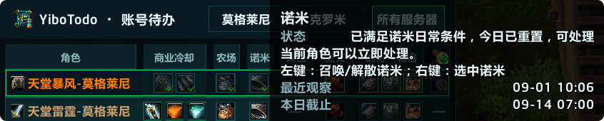
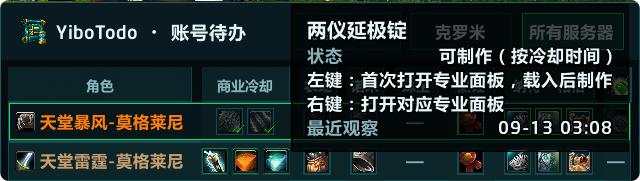

# 截图补充清单

状态：**2 张 Todo 补充图已备好；其它项目已列复用或补拍需求，尚未上传 CF、尚未完成新实机补拍。**

只选实际游戏画面。概念图、_NonRelease 联动验收图不作为已发布功能图。下面的图库数量/文件名来自本轮公开页面，可能受缓存影响；“待目检”表示尚未逐张检查其画面，不能据文件名认定过期。

## 已备好可新增图片

| 文件 | 原始来源 | 中文图注 | English caption | 用途 |
| --- | --- | --- | --- | --- |
| [YiboTodo-Nomi-Daily.png](screenshots/YiboTodo-Nomi-Daily.png) | YiboTodo/Media/1.1-1.png | 诺米日常：查看当前状态、最近观测，以及召唤或选中诺米的操作提示。 | Nomi daily status and supported summon or target actions. | 1.1 发布期实机画面；CF 返回图库未列此图，作为补充图候选 |
| [YiboTodo-Profession-Cooldown.png](screenshots/YiboTodo-Profession-Cooldown.png) | YiboTodo/Media/1.1-2.png | 专业冷却：查看两仪延极锭的可制作状态与专业操作提示。 | Profession cooldown readiness and supported profession actions. | 同上；不是全功能主图 |

两图均已实际查看并原样复制，未重绘、拼接或更改界面。图中的“可制作”依据冷却；文案必须保留“不证明材料齐全”的说明。图中角色名来自作者已有公开素材。上传前如需匿名化，另行制作副本，不覆盖原图。

## 逐项目图库与补拍

| 项目 | 当前 CF 公开图库 | 本地核对情况 | 推荐图序与补拍内容 | 优先级 |
| --- | --- | --- | --- | --- |
| AltoBoss | 返回3图，包含早期画面；网页版本缓存有差异 | 已查看 PrivacySafe/overview-privacy.png，为1.2.1旧窗口，不适合新版主图 | ①2.5.1账号首领矩阵 ②副本锁定页/首领详情 ③悬停预览；节日图仅在真实开放期拍 | 高 |
| AutoOpen | 1图：1.0.png | 图库画面待目检；1.0图片无法证明后来新增定位设置 | ①1.2.2允许目录及队列设置 ②来源白名单与原生绑定框定位；必须展示仍需人工确认 | 中 |
| BeastPaths | 5图，包括1.6-1至1.6-4及6月旧图 | 图库新图待目检；本地早期地图图可追溯 | 优先检查1.6图：①区域地图路线 ②小地图局部路线 ③宠物节点提示；覆盖齐全则无需重拍 | 低 |
| Builds | 4图，含1.3.0-1及1.0/1.1图 | 已看1.3.0-1：真实装备工作台，功能可读，但版本标题为1.3.0 | ①1.4.2工作台与提升候选 ②账号专精预览 ③当前角色可执行的镶嵌/增强操作；1.3图可暂留参考 | 高 |
| Core | 3张8月15日图 | 已看本地1.2.0-1，仍是旧概览布局 | ①1.9.0账号框架/实际安装业务页 ②角色目录与范围 ③统一设置；补拍不包含未发布行动中心 | 高 |
| Crafting | 2图：1.0.0-1/2 | 已看1.0.0-1：专业列表、配方详情及已学/待确认，符合发布版 | ①配方矩阵 ②专业/详情，先复用现有1.0.0图；不要用1.0.6三态目录图替换 | 低 |
| Currency | 5图：0.7.0及0.3.0-1至4 | 已看0.7.0：完整账号矩阵，可展示主用途 | ①0.9.1精选常用货币矩阵 ②自定义物品添加 ③物品代币来源明细/覆盖提示；旧图可暂作主用途参考 | 中 |
| Legendary | 3图：2.1.0-1至3 | 图库版本对应发布版，但画面待目检；本地8月图更旧 | 核对现有2.1图能否覆盖①目标目录 ②披风章节/下一步 ③武器收集检查点；缺哪项补哪项 | 中 |
| Mail | 10图：1.0.0系列 | 已看1、8、9、10：收件箱、业务设置、规则管理及缓存设置；有真实规则寄件入口 | ①1.2.2收件箱/附件箱 ②通讯录与快捷栏 ③实际规则寄件预览 ④账号总览/历史；旧空列表和设置图不要占首图 | 高 |
| Mounts | 5图：0.5三图、0.7两图 | 已确认本地文件存在；画面待目检 | 检查是否已覆盖①坐骑面板来源 ②骑乘单位/光环 ③聊天链接；缺少0.8.5新入口示例才补拍 | 中 |
| QuestBlocker | 本次公开页抓取失败，数量待查 | 本地有8月18日两图，尚未目检 | ①3.0.2任务×角色矩阵 ②拒绝/放弃/暂停模式 ③添加任务及兼容提示；先核后台图库 | 高 |
| Reputation | 2图：1.2-1/2 | 图库画面待目检 | ①1.5.2账号监控矩阵 ②当前角色声望树 ③友好度项目；已有画面仍一致则保留 | 中 |
| Todo | 返回5图，含1.0及0.4/0.3/0.2.1旧图 | 已看本地1.1-1/2，可补诺米与专业操作 | ①1.1.2主矩阵，显示专业/农场/诺米等真实监控项 ②本次两张补充图 ③活动项目示例；旧0.x图无需继续占首位 | 高 |
| Vault | 2图：1.0.0-1/2 | 均已看，为个人背包与公会页签；主要功能仍可说明 | 保留两图，补①物品Tooltip账号数量与位置 ②跨角色物品搜索/来源状态；新版历史缓存符号需用1.1.1截图 | 中 |

## 补拍执行要求

- 使用与本次发布基线一致的包；记录插件版本、Core版本、客户端版本和截图日期。截图不为展示而修改业务数据或伪造完成状态。
- 主图选有实际数据、能看懂主要用途的一屏；待确认、历史缓存等真实边界可以保留。不要以全空列表作为主图。
- 保留必要窗口上下文。裁切目标是让内容在 CF 卡片或图库预览里可读，不把重要状态、版本或操作结果裁掉。
- 先截图主要场景，再补一个关键操作或提示。通常两至四张能覆盖用途即可，不机械增加图数。
- 所有上传图加“功能场景”中英标题；纯文件名与版本号不是图注。
- 新图作为候选追加并核对在线效果。旧图移除属于外部图库修改，执行时应按实际已确认范围操作；本轮未删任何本地素材或在线图片。
