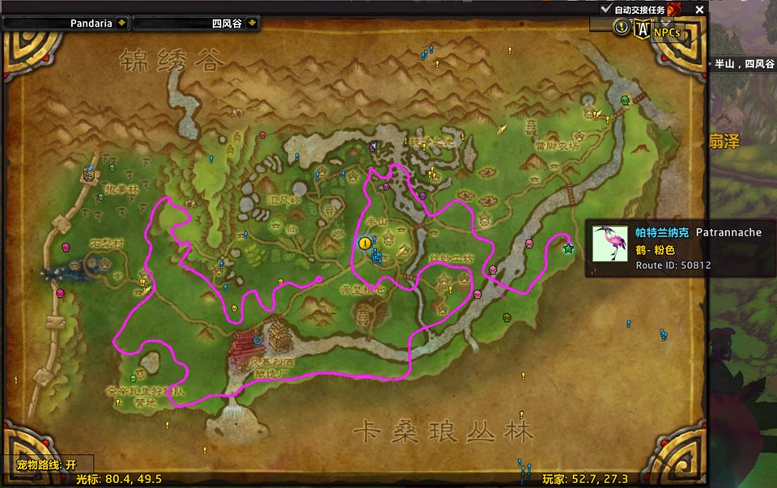

# YiboBeastPaths

> 文档状态更新（2026-10-16）：现有路线与维护功能已实机验收收口；后续宠物功能见DEV-002。当前源码版本与发行证据见[状态总览](../Docs/仓库当前状态总览.md)，后续任务见[延期清单](../Docs/后续开发任务清单.md)。下文旧版本的开发／待验收描述按其原日期理解；当前版本渠道状态没有明确证据时保留待核对。

潘达利亚隐藏猎人宠物路线图插件。  
作用是把部分稀有猎人宠物的巡逻/活动路线直接覆盖显示在世界地图上，方便在游戏内快速查看和蹲守。

当前开发版本：`1.9.0`，Retail／Mists 的 Core 双标签页面和目标清单已接入；兽栏正向观察会保存采集时间并标注完整性未确认，不推断空栏或未拥有。两端已验证采集及完整退出重登恢复，完整验收和发行检查尚未完成，不能发布。路线“已拥有”与噩兆四色属于后续 DEV-005，详见[版本任务清单](Docs/离线兽栏与拥有状态-版本任务清单.md)。

## 界面预览

## 当前状态

- 已接入世界地图路线覆盖显示。
- 已接入小地图局部路线显示。
- 已提供地图左下角开关按钮，可直接切换路线显示。
- 已提供插件列表图标资源。
- 已为每条路线提供起点标记与悬浮信息。
- 已移除按钮切换时的聊天框刷屏提示。
- 已提供 `Maintenance/` 路线维护模块；Retail 与 MoP 可通过具备 API13 和所需能力的 YiboCore 使用，维护页面默认接入。
- Core 维护页、统一设置、地图开关与命令提示接入 Core 会话语言；独立运行模式按客户端语言显示这部分中英文文案。详见 [Core 接入与验收](Docs/Core-API13-接入说明.md)。

## 当前收录宠物

目前仓库内已收录 10 条潘达利亚隐藏猎人宠物路线：

- `50811` 重蹄 `Stompy`
- `50812` 帕特兰纳克 `Patrannache`
- `50813` 噩兆 `Portent`
- `50816` 刺脊 `Bristlespine`
- `50817` 血牙 `Bloodtooth`
- `50818` 赫克萨波斯 `Hexapos`
- `50820` 洛克海德 `Rockhide the Immovable`
- `50821` 萨维奇 `Savage`
- `50822` 微光之蛾 `Glimmer`
- `66522` 桑蚕 `Bombyx`

## 功能说明

- 在世界地图对应区域显示该地图下的宠物路线覆盖图。
- 在小地图范围内显示当前附近的局部路线线段。
- 路线起点会显示额外节点标记。
- 鼠标悬停节点时会显示宠物名称、英文名、外观标签、脚印名称和路线 ID。
- 地图左下角按钮可切换 `宠物路线: 开/关`。
- 支持命令：
  - `/ybp`
  - `/ybp show`
  - `/ybp hide`
  - `/ybp stable`（打开 Core 离线兽栏页面）
  - `/ybp debug`（Retail／MoP；需要兼容的 YiboCore API13）
  - `/ybp mmdebug`

## 安装方式

1. 将插件目录放入对应客户端：
   - Retail / 正式服：`World of Warcraft/_retail_/Interface/AddOns/`
   - MoP Classic：`World of Warcraft/_classic_/Interface/AddOns/`
2. 保证最终目录结构类似：
   `Interface/AddOns/YiboBeastPaths/`
3. 进入游戏后启用插件。

1.9 继续使用仅支持 Retail／Mists 的双端共用包，三个 TOC 均与 1.8.3 的同名路径对应。旧包保留文件覆盖后的实际客户端加载和存档恢复尚未验证；1.9 仍在开发，不是可发布包。进行安装或升级验证时应保留 `WTF` 中的设置和存档。

源码包含目标清单；各玩家包仅包含所选目标并加载默认 TOC：

- `YiboBeastPaths.toc`：源码缺目标提示；玩家包中的同名文件是所选目标入口
- `YiboBeastPaths_Mainline.toc`：Retail / 正式服
- `YiboBeastPaths_Mists.toc`：MoP Classic 专用入口，供支持 `_Mists` suffix 的客户端识别

## 主要文件

- [YiboBeastPaths.toc](YiboBeastPaths.toc)：源码缺目标提示入口
- [YiboBeastPaths_Mainline.toc](YiboBeastPaths_Mainline.toc)：Retail / 正式服入口与元数据
- [YiboBeastPaths_Mists.toc](YiboBeastPaths_Mists.toc)：MoP Classic 入口与元数据
- [Flavor.lua](Flavor.lua)：运行时客户端 flavor 识别
- [FlavorOverrides.lua](FlavorOverrides.lua)：Retail/Mists 数据覆盖入口
- [Core.lua](Core.lua)：初始化、按钮与命令
- [Renderer.lua](Renderer.lua)：世界地图路线绘制与节点显示
- [Data.lua](Data.lua)：宠物基础数据
- [RouteOverlays.lua](RouteOverlays.lua)：路线覆盖图资源映射
- [RouteNodes.lua](RouteNodes.lua)：路线节点与提示数据
- [RouteTransforms.lua](RouteTransforms.lua)：每条路线的定位参数
- [Maintenance/DebugCalibrator.lua](Maintenance/DebugCalibrator.lua)：路线调试校准面板

## 更新日志

所有版本更新内容统一维护在 [CHANGELOG.md](CHANGELOG.md)。

## 说明

- 当前路线效果依赖覆盖图资源与定位参数。
- 如果某条路线位置仍需微调，可在 Retail 或 Mists 安装兼容的 YiboCore；Core 就绪后维护页面自动注册，使用 `/ybp debug` 打开工作台。

## 行动中心主动添加（2026-10-10 工作树）

本轮审查为当前对象不适用：路线／起点说明未提供角色驯服完成证据，不注册占位目标。

实际契约、自动化与客户端待验收范围见 [实施与验证](../Docs/行动中心-主动添加实施与验证.md)。

## 图标资源（2026-10-14）

当前图标为 `Media/YiboBeastPathsIcon`：默认TGA为64px，插件列表使用128px TGA；PNG提供16/24/32/64/128/512/1024px，母版为312px透明位图。版本、统一缩放和验证范围见[系列资源记录](../Docs/Design/Yibo系列Logo-20261014/README.md)。

